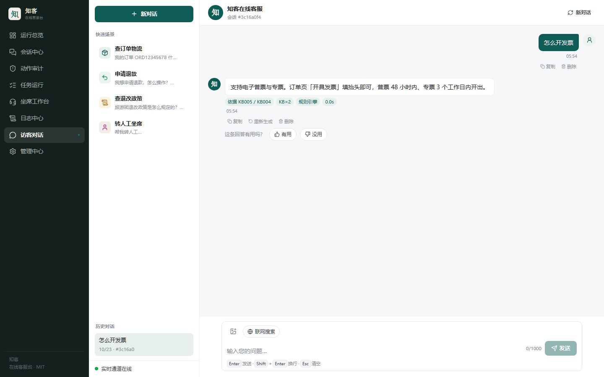
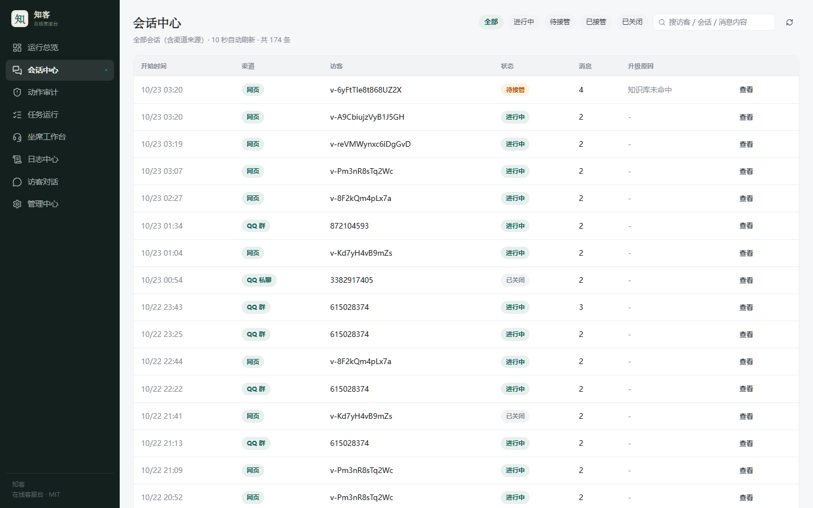
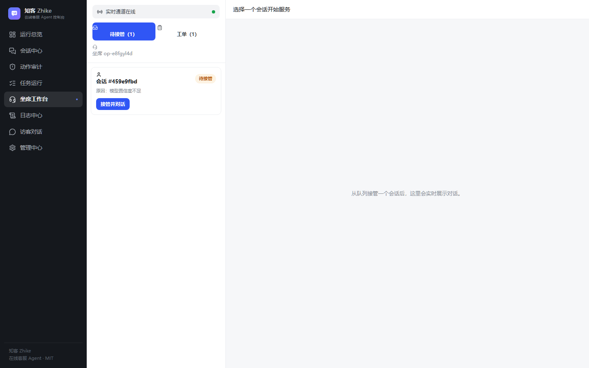
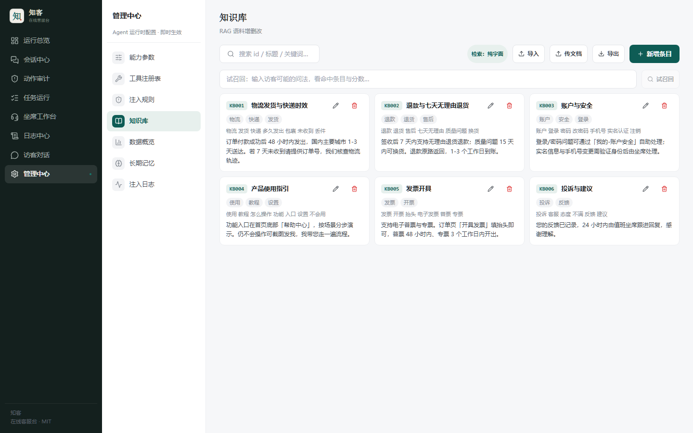
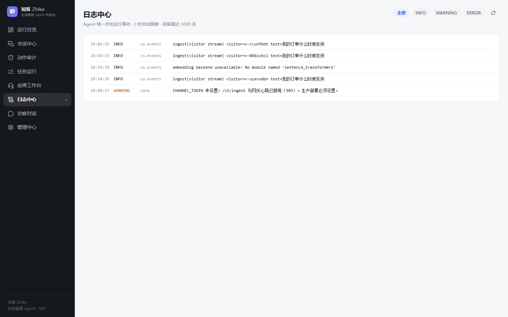

# Zhike

**A self-hosted personal secretary for QQ and the Web — running on hardware you own.**

[中文](README.md) · [Architecture](docs/ARCHITECTURE.md) · [Deploy](DEPLOY.md) · [Changelog](CHANGELOG.md) · [Roadmap](ROADMAP.md)

<p align="center">
  
</p>

<p align="center">
  <a href="#quick-start"><b>Quick start</b></a> ·
  <a href="#what-it-does">What it does</a> ·
  <a href="#screenshots">Screenshots</a> ·
  <a href="#cli">CLI</a> ·
  <a href="#windows-exe">Windows exe</a> ·
  <a href="#honest-limits">Honest limits</a>
</p>

---

## Quick start

Three commands. Python 3.12+ only; no Node, no Docker, no config file to hand-edit.

```bash
pip install -e .
zhike init
zhike run
```

Open <http://127.0.0.1:8010>. `init` generates the admin and channel tokens for you and prints
the admin token once; `run` starts the server and tells you if the port is taken.

Prefer the console? A first-run wizard walks you through model setup, the optional QQ channel,
and a self-check. It appears only on the machine hosting Zhike, and only once.

## Screenshots

<table>
<tr>
<td width="50%"><br><sub><b>Dashboard</b> — traffic, escalations, tool ranking</sub></td>
<td width="50%"><br><sub><b>Chat</b> — citations, latency, engine mode</sub></td>
</tr>
<tr>
<td><br><sub><b>Sessions</b> — filter, search, replay</sub></td>
<td><br><sub><b>Operator desk</b> — live human handoff</sub></td>
</tr>
<tr>
<td><br><sub><b>Personas</b> — 15 presets, structured character cards</sub></td>
<td><br><sub><b>Knowledge</b> — import, edit, trial recall</sub></td>
</tr>
<tr>
<td><br><sub><b>Reminders</b> — natural-language scheduling</sub></td>
<td><br><sub><b>Logs</b> — live events with request IDs</sub></td>
</tr>
</table>

---

## What it does

Zhike is an agent harness, not a chat wrapper. The loop selects tools, executes them, checks
budgets, and records every step.

| | |
|---|---|
| **Executes, not advises** | 42 registered tools. The model picks; the loop runs, validates, and detects repeated actions. |
| **Tiered permissions** | Every mutating action is L0/L1/L2. Destructive actions require explicit approval — nothing escalates silently. |
| **Hash-chained audit** | Who asked, what ran, what changed. Tamper-evident and verifiable from the console. |
| **Hybrid retrieval** | SQLite FTS5 BM25 fused with optional `sqlite-vec` vectors via RRF; degrades to keyword search when no embedding model is present. |
| **Runs without an LLM key** | Rules and retrieval keep working. QQ replies continue in rule mode instead of going silent. |
| **Multi-provider failover** | Parallel racing with cooldown, plus content-level failover when a reply is empty or truncated. |
| **QQ-first** | NapCat / OneBot v11 gateway with group throttling, bot-to-bot loop guard, emote learning, voice in and out. |

| Area | Included |
|---|---|
| **Channels** | QQ groups and private chat (OneBot v11), embedded web chat, operator desk over WebSocket |
| **Agent** | Multi-step ReAct, native function calling with JSON fallback, per-run token and wall-clock budgets, cancellation |
| **Knowledge** | Markdown / text / PDF / DOCX / XLSX import, trial-recall playground, export, per-entry CRUD |
| **Memory** | Long-term preferences and session notes; opt-out is respected and persisted |
| **Reminders** | Chinese natural time (`十分钟后`, `每天八点`, `每月三十一号`) plus ISO timestamps and recurrence rules |
| **Voice** | faster-whisper transcription and edge-tts synthesis, both optional |
| **Personas** | 15 presets across 6 categories, each with a structured character card and a drift guard |
| **Ops** | Prometheus metrics, request IDs, `/healthz` and `/readyz`, multi-stage Docker image, non-root |

---

## CLI

```
zhike init      # create .env, generate tokens, create the database
zhike run       # start the server (--gateway also starts the QQ gateway)
zhike doctor    # check deps, tokens, ports, database, frontend, service health
zhike status    # show current config and live service state
zhike version   # version and paths
```

`zhike doctor` is the first thing to run when something looks wrong. It reports what is
actually true — whether the port is taken, whether the service answering on it is this version,
and whether a model key is configured — instead of making you guess from a blank page.

```bash
$ zhike doctor
✓ .env exists
✓ ADMIN_TOKEN set (64 chars)
✓ Python dependencies present
✓ database exists (0.8 MB)
✓ frontend build present
! no model API key — running in rule mode
✓ port 8010 free
```

---

## Windows exe

A single-file executable built with PyInstaller; no Python required on the target machine.

```bash
python scripts/build_exe.py          # build + smoke test
dist-exe/zhike.exe                   # 60 MB, self-contained
```

Double-clicking the exe with no arguments initializes on first launch and starts the server.
Writable data (database, logs, `.env`) goes to `zhike-data/` next to the exe, or
`%LOCALAPPDATA%\Zhike` when that directory is read-only. Read-only assets (knowledge seed,
character cards, console build) ship inside the binary.

> PyInstaller is a deliberate choice for a single-file download, not the industry default —
> most comparable projects ship Electron/Tauri shells or Docker only. The build script verifies
> `/healthz`, `/readyz`, the console page, and a real tool call before declaring success.

---

## Docker

```bash
docker build -t zhike .
docker run -d -p 8010:8010 \
  -e ADMIN_TOKEN=change-me -e CHANNEL_TOKEN=change-me-too \
  -v zhike-data:/app/.tmp zhike
```

---

## Connect QQ

QQ is optional; the web console works without it.

```bash
python scripts/qq_doctor.py     # tells you which path fits this machine
```

```bash
# A. Containerized (recommended) — host QQ version is irrelevant, scan a QR once
docker compose -f docs/napcat-compose.yaml up -d

# B. Local injection — reuses desktop QQ credentials, no QR, but version-sensitive
python scripts/napcat_local.py start --qq <your-account>
```

The console also deploys and starts the protocol end from the UI (Settings → Channels → QQ).

> Local injection breaks silently after a QQ auto-update: the process is alive, no port answers,
> and the log only says `Process resumed`. If that repeats, switch to the container path.
> See [docs/QQ-LOGIN.md](docs/QQ-LOGIN.md) and [docs/QQ-LOCAL.md](docs/QQ-LOCAL.md).

---

## Configuration

Three layers resolve in order: **code defaults → environment → database**. The console writes
the database layer, so tuning takes effect without a restart. Every supported key is documented
in [`.env.example`](.env.example).

---

## Verify it works

```bash
pytest tests -q                                   # unit and integration suite
ruff check core executor gateway scripts tests     # lint
python scripts/harness_all.py                     # offline regression: personas, version, emotes
cd frontend && npm test && npm run build          # frontend tests and build
```

`scripts/e2e_check.py` exercises a **running instance** end to end: retrieval, tools, guardrails,
memory, rate limiting, human handoff, config hot-reload, knowledge CRUD, and WebSocket push.

> It writes sessions, messages, and tickets, then removes its test data. Run it against an
> isolated instance only — never against production or a real QQ group.

---

## Honest limits

These are real boundaries, not disclaimers:

- **External services stay external.** Models, web search, QQ delivery, vision, voice, and business
  tools all depend on network, credentials, and vendor availability. The console reports
  "configured", which is not the same as "reachable right now".
- **Reminder time zones.** Natural-language parsing and delivery depend on the entry point and the
  server time zone. Verify in the target environment before relying on it.
- **Budgets are checked around calls**, not enforced as a hard per-request ceiling.
- **WeCom and WeChat Official Account are adapter skeletons**, not production-ready integrations.
- **File operations require a separate executor** and an explicit policy; disabled by default.

---

## Project

- [CHANGELOG.md](CHANGELOG.md) — per-release changes, Keep a Changelog format
- [ROADMAP.md](ROADMAP.md) — what is planned, and what is explicitly not
- [docs/RELEASING.md](docs/RELEASING.md) — release process and branch policy
- [docs/research/COMPETITIVE-RESEARCH.md](docs/research/COMPETITIVE-RESEARCH.md) — how this compares to 12 comparable projects
- [CONTRIBUTING.md](CONTRIBUTING.md) — development setup and commit conventions
- [SECURITY.md](SECURITY.md) — how to report issues privately

`main` is the only long-lived branch. The version string lives in `VERSION`, `core/version.py`,
and `pyproject.toml`, kept in sync by `scripts/check_version.py`.

## License

[MIT](LICENSE). NapCat is an independent, unofficial protocol implementation — check its license
and platform rules before commercial use.
