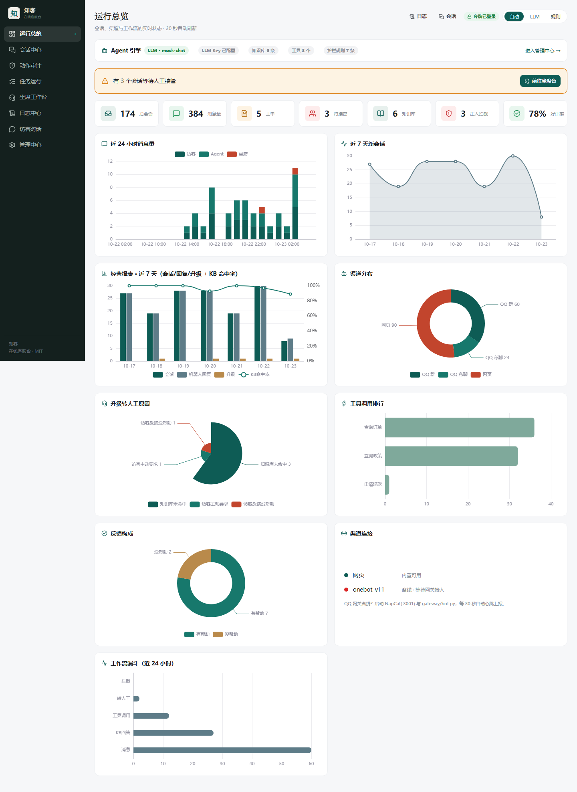
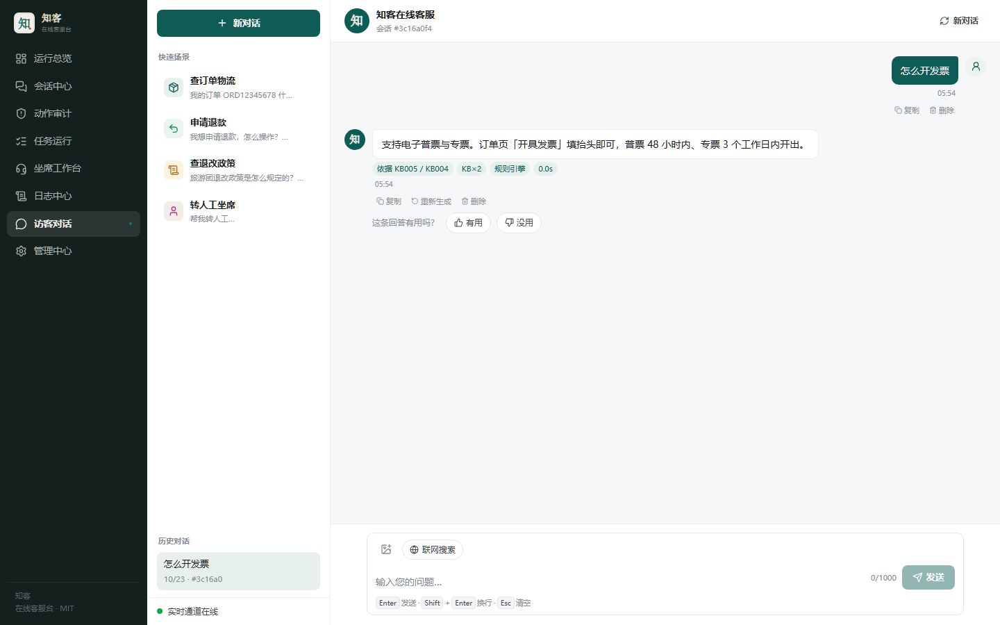
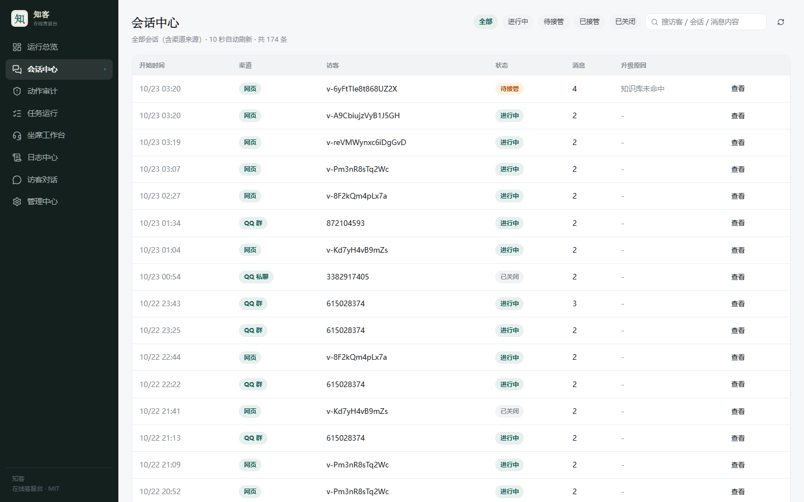
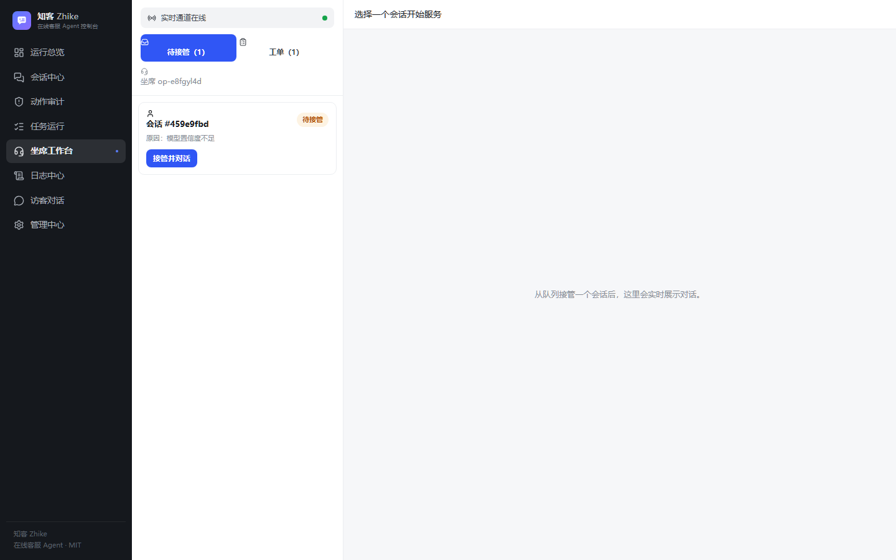
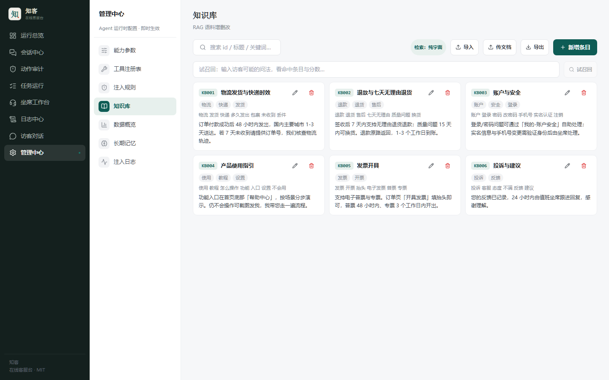
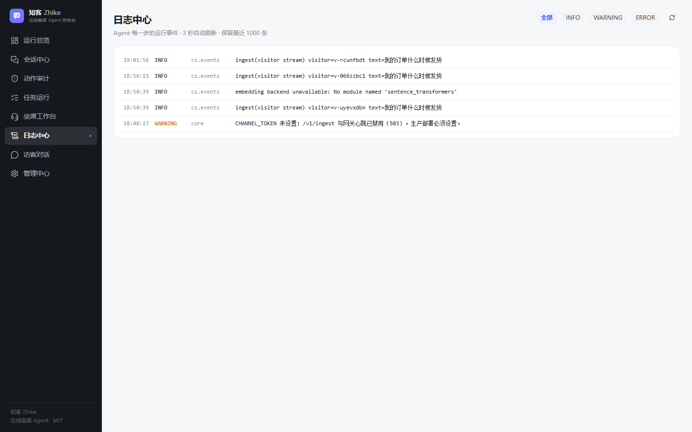

# 知客 Zhike

**你自己的私人秘书 —— 跑在 QQ 和网页上，也跑在你自己的机器上。**

[English](README.en.md) · [架构说明](docs/ARCHITECTURE.md) · [部署手册](DEPLOY.md) · [更新日志](CHANGELOG.md) · [路线图](ROADMAP.md)

<p align="center">
  
</p>

<p align="center">
  <a href="#快速开始"><b>快速开始</b></a> ·
  <a href="#它能做什么">它能做什么</a> ·
  <a href="#界面">界面</a> ·
  <a href="#命令行">命令行</a> ·
  <a href="#windows-exe">Windows exe</a> ·
  <a href="#诚实的限制">诚实的限制</a>
</p>

---

## 快速开始

三条命令。只需要 Python 3.12+，不需要 Node，不需要 Docker，不用手改配置。

```bash
pip install -e .
zhike init
zhike run
```

打开 <http://127.0.0.1:8010>。`init` 会自动生成管理员令牌和渠道令牌，并把管理员令牌打印一次；
`run` 启动服务，端口被占用时会直接告诉你。

习惯用界面？首次启动会有一个向导，带你配模型、可选接入 QQ、跑一次自检。它只在本机出现，
而且只出现一次。

## 界面

<table>
<tr>
<td width="50%"><br><sub><b>运行总览</b> — 流量、升级原因、工具排行</sub></td>
<td width="50%"><br><sub><b>网页对话</b> — 引用、耗时、引擎模式</sub></td>
</tr>
<tr>
<td><br><sub><b>会话中心</b> — 筛选、搜索、回放</sub></td>
<td><br><sub><b>坐席工作台</b> — 人工实时接管</sub></td>
</tr>
<tr>
<td><br><sub><b>秘书人设</b> — 15 个预设，结构化角色卡</sub></td>
<td><br><sub><b>知识库</b> — 导入、编辑、试召回</sub></td>
</tr>
<tr>
<td><br><sub><b>提醒待办</b> — 中文自然时间</sub></td>
<td><br><sub><b>日志中心</b> — 带关联 ID 的实时事件流</sub></td>
</tr>
</table>

---

## 它能做什么

知客是 agent harness，不是给 API Key 套个聊天框。循环负责选工具、执行、核对预算，
并记录每一步。

| | |
|---|---|
| **真执行，不是给建议** | 42 个已注册工具。模型负责选，循环负责执行、校验、检测重复动作。 |
| **分级动作权限** | 每个写操作都带 L0/L1/L2 风险级别，破坏性动作必须显式审批，不存在悄悄升级。 |
| **哈希链审计** | 谁提的、跑了什么、改了什么，防篡改，控制台可一键校验。 |
| **混合检索** | SQLite FTS5 BM25 与可选的 `sqlite-vec` 向量经 RRF 融合；没有向量模型时干净降级为关键词检索。 |
| **没有模型 Key 也能用** | 规则与检索照常工作，QQ 在显式规则模式下正常回复，而不是静默不回。 |
| **多厂商备援** | 多端点并行竞速 + 冷却熔断，另有内容级备援：回复为空或被截断时自动换模型。 |
| **QQ 优先** | NapCat / OneBot v11 网关，带群节流、机器人对机器人循环护栏、表情包学习、语音收发。 |

| 方面 | 已包含 |
|---|---|
| **渠道** | QQ 群聊与私聊（OneBot v11）、内嵌网页对话、WebSocket 坐席工作台 |
| **Agent** | 多步 ReAct、原生 function calling 与 JSON 降级、单次运行 token 与耗时预算、可取消 |
| **知识库** | Markdown / 文本 / PDF / DOCX / XLSX 导入、试召回、导出、逐条增删改 |
| **记忆** | 长期偏好与会话笔记；用户要求不记时尊重并持久化该选择 |
| **提醒** | 中文自然时间（`十分钟后`、`每天八点`、`每月三十一号`）与 ISO 时间、周期规则 |
| **语音** | faster-whisper 语音转写、edge-tts 语音合成，均为可选 |
| **人设** | 6 大类 15 个预设，每个带结构化角色卡与设定漂移守卫 |
| **运维** | Prometheus 指标、请求关联 ID、`/healthz` 与 `/readyz`、多阶段镜像、非 root |

---

## 命令行

```
zhike init      # 创建 .env、生成令牌、建库
zhike run       # 启动服务（--gateway 同时启动 QQ 网关）
zhike doctor    # 体检：依赖、令牌、端口、数据库、前端、服务健康
zhike status    # 查看当前配置与实时服务状态
zhike version   # 版本与路径
```

出问题时第一件事是跑 `zhike doctor`。它报告的是**实际状态**——端口有没有被占、
占用它的服务是不是这个版本、模型 Key 到底配没配——而不是让你对着空白页猜。

```bash
$ zhike doctor
✓ .env 存在
✓ ADMIN_TOKEN 已设置（64 字符）
✓ Python 依赖齐全
✓ 数据库存在（0.8 MB）
✓ 前端产物已就绪
! 未配置模型 API Key，将以规则模式运行
✓ 端口 8010 可用
```

---

## Windows exe

用 PyInstaller 打成单文件，目标机器不需要装 Python。

```bash
python scripts/build_exe.py          # 构建 + 冒烟验证
dist-exe/zhike.exe                   # 60 MB，自带全部依赖
```

双击（不带参数）会先自动初始化，再启动服务。可写数据（数据库、日志、`.env`）放在 exe 同级的
`zhike-data/`，该目录不可写时改用 `%LOCALAPPDATA%\Zhike`。只读资源（知识库种子、角色卡、
控制台构建产物）打进二进制内部。

> 选 PyInstaller 是为了「下载一个文件就能跑」，它**不是**业界默认做法——同类项目多数发
> Electron/Tauri 外壳或只发 Docker。构建脚本会在宣布成功之前，真实验证 `/healthz`、
> `/readyz`、控制台页面和一次真实的工具调用。

---

## Docker

```bash
docker build -t zhike .
docker run -d -p 8010:8010 \
  -e ADMIN_TOKEN=change-me -e CHANNEL_TOKEN=change-me-too \
  -v zhike-data:/app/.tmp zhike
```

---

## 接入 QQ

QQ 是可选渠道，不接也不影响网页端。

```bash
python scripts/qq_doctor.py     # 判断这台机器该走哪条路
```

```bash
# A. 容器版（推荐）：宿主机 QQ 版本与你无关，首次扫码一次
docker compose -f docs/napcat-compose.yaml up -d

# B. 本机注入：复用桌面 QQ 的登录凭据，免扫码，但对版本敏感
python scripts/napcat_local.py start --qq <你的账号>
```

控制台里也能直接部署并启动协议端（设置 → 渠道连接 → QQ）。

> 本机注入在 QQ 自动升级后会**静默失效**：进程在，端口全不通，日志只写 `Process resumed`。
> 反复遇到就换容器版。排障细节见 [docs/QQ-LOGIN.md](docs/QQ-LOGIN.md) 与
> [docs/QQ-LOCAL.md](docs/QQ-LOCAL.md)。

---

## 配置

配置三层解析：**代码默认值 → 环境变量 → 数据库**。控制台写的是数据库层，
所以调参即改即生效，不用重启。全部支持的键见 [`.env.example`](.env.example)。

---

## 验证它真的能用

```bash
pytest tests -q                                    # 单元与集成测试
ruff check core executor gateway scripts tests      # lint
python scripts/harness_all.py                      # 离线回归：角色一致性、版本、表情包标签
cd frontend && npm test && npm run build           # 前端测试与构建
```

`scripts/e2e_check.py` 会对**运行中的实例**做端到端体检：检索、工具、护栏、记忆、限流、
人工接管、配置热更新、知识库增删改、WebSocket 推送。

> 它会写入会话、消息与工单，并删除测试数据。**只能对隔离实例运行**，
> 不要指向生产库或真实 QQ 群。

---

## 诚实的限制

这些是真实的边界，不是免责声明：

- **外部服务就是外部的。** 模型、联网搜索、QQ 投递、视觉、语音与业务工具都依赖网络、凭据与
  厂商可用性。控制台报告的是「已配置」，不等于「此刻可达」。
- **提醒时区。** 自然语言解析与投递取决于入口与服务器时区，依赖前请在目标环境验证。
- **预算是在调用前后核对的**，不是单次请求的硬性上限。
- **企业微信与公众号渠道是适配骨架**，不是可直接上生产的接入。
- **文件操作需要单独的执行器**与显式策略，默认不可用。

---

## 项目管理

- [CHANGELOG.md](CHANGELOG.md) — 每个版本的变更，Keep a Changelog 格式
- [ROADMAP.md](ROADMAP.md) — 计划做什么，以及明确不做什么
- [docs/RELEASING.md](docs/RELEASING.md) — 发布流程与分支策略
- [docs/research/COMPETITIVE-RESEARCH.md](docs/research/COMPETITIVE-RESEARCH.md) — 与 12 个同类项目的逐项对比
- [CONTRIBUTING.md](CONTRIBUTING.md) — 开发环境与提交规范
- [SECURITY.md](SECURITY.md) — 私下报告安全问题的方式

`main` 是唯一长期分支。版本号存在于 `VERSION`、`core/version.py` 与 `pyproject.toml`，
由 `scripts/check_version.py` 强制保持一致。

## 许可

[MIT](LICENSE)。NapCat 是独立的非官方协议端实现，商用前请自行确认其许可与平台规则。
